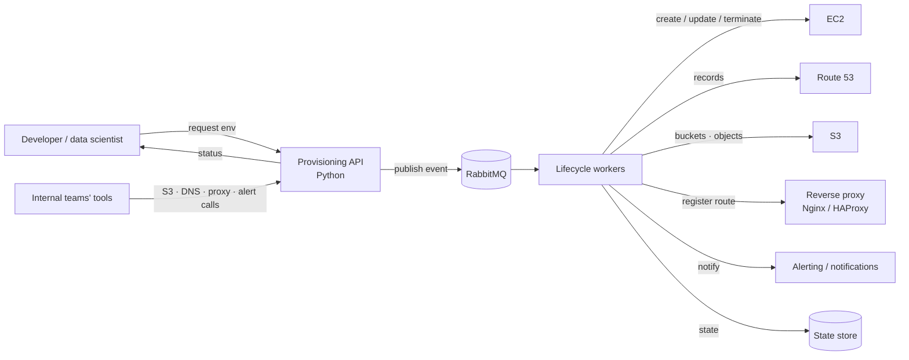

# Event-Driven Infrastructure Provisioning Platform

 -lightgrey) 

> **Architecture write-up.** This documents a system I designed and built as a DevOps Engineer at Faclon Labs (Mumbai). The implementation belongs to my employer and is not published; what follows is the design, the moving parts and the outcomes, with internal names and details left out.

A Python platform that gives 60–70 developers and data scientists self-service
AWS environments: an EC2 environment is created, updated and deleted through
an API instead of a ticket, and the plumbing around it — DNS, storage, proxy
registration, alerts — happens as a consequence of the request rather than as
separate manual steps. Its abstraction APIs for S3, Route 53, the proxy layer
and alerting are consumed by 2–3 internal teams.

## The problem

Every new development or data-science environment meant someone with cloud
access creating an instance, a DNS record, storage, a proxy route and
monitoring by hand — and remembering to tear it all down later. Engineers
waited, operators repeated themselves, and leftover resources cost money.

## Architecture

## Components

| Part | Role |
|---|---|
| **Provisioning API** | Validates a request, records the desired state, publishes a lifecycle event, answers status queries. |
| **Message queue (RabbitMQ)** | Decouples the request from the (slow) cloud work; a burst of requests queues instead of timing out. |
| **Lifecycle workers** | Consume events and drive the AWS SDK: instance lifecycle, tags, DNS, storage, proxy registration, alerting hooks. Idempotent, so a retried event is safe. |
| **Abstraction APIs** | Narrow, opinionated endpoints for S3 operations, Route 53 automation, proxy services and alerting, so other teams never touch raw cloud credentials. |
| **State store** | What exists, who owns it, when it was last touched — the basis for updates, teardown and cost hygiene. |

## How a request flows

1. An engineer asks for an environment (size, purpose, owner).
2. The API checks the request, stores the intent and publishes a `create` event.
3. A worker provisions the instance, creates the DNS record, prepares storage,
   registers the HTTPS route on the central proxy and wires alerting.
4. The engineer gets a hostname they can use — no cloud console involved.
5. `update` and `delete` follow the same path, so environments change and
   disappear the same way they appeared.

## Outcomes

- Self-service environments for **60–70** developers and data scientists.
- Lifecycle (create / update / delete) fully automated.
- Infrastructure abstraction APIs reused by **2–3 internal teams**.
- Far less dependence on engineers having direct cloud-infrastructure knowledge.

## Stack

Python · AWS (EC2, Route 53, S3, IAM) · RabbitMQ · Nginx / HAProxy · Prometheus / Grafana alerting

## My role

Designed and developed the platform end to end: API design, event model,
workers, the AWS abstractions and their rollout to other teams.
