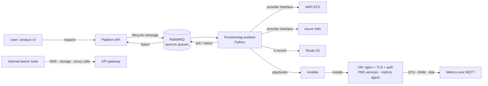

# Event-Driven Infrastructure Provisioning Platform (Compute Module)

 -lightgrey) 

> **Architecture write-up.** This documents a system I designed and built as a DevOps Engineer at Faclon Labs (Mumbai). The implementation belongs to my employer and is not published; what follows is the design, the moving parts and the outcomes, with internal names and details left out.

A Python platform that turns a message into a ready-to-use compute
environment. A user (a data scientist, an engineer, or a customer of the
product) asks for a machine of a given size with the tools they need; a worker
provisions an isolated VM on **AWS or Azure**, gives it a static IP, a DNS name,
TLS and authentication, and installs the requested tools from a catalogue of
**12 services** with Ansible. Resizing, stopping, adding a tool or deleting
the machine go through the same message path. Today it runs **~25 large VMs**
in production and is also installed on-prem for customers. Its abstraction
APIs for DNS, storage and the proxy layer are consumed by 2–3 internal teams,
and the self-service model serves 60–70 engineers.

It started in 2024 as a single-cloud prototype; the current version is
multi-cloud with the provider behind one interface.

## The problem

Every new development, data-science or customer environment meant someone
with cloud access creating an instance, a DNS record, storage, a proxy route,
credentials and monitoring by hand, installing the tools the user wanted, and
remembering to tear it all down later. Engineers waited, operators repeated
themselves, and leftover resources cost money. The product also needed the
same environments for its own users, on whichever cloud a customer required.

## Architecture

## Components

| Part | Role |
|---|---|
| **Lifecycle messages** | Eight incoming types — create, start, stop, resize CPU/RAM, resize disk, add service, remove service, delete — and an acknowledgement for each, so the product UI always knows the state. |
| **Message queue (RabbitMQ)** | Decouples the request from the slow cloud work; quorum queues and manual acknowledgements mean a worker crash costs a redelivery, not a lost environment. |
| **Provider interface** | One class per cloud (AWS EC2, Azure Virtual Machines) with the same operations: allocate IP, create from image, start, stop, change size, grow disk, delete. The workers never know which cloud they are on. |
| **Tool catalogue** | 12 Ansible-installed services — MLflow, Airflow, JupyterLab, a Jupyter shell, VS Code Server, Node-RED, MongoDB, PostgreSQL, RabbitMQ, Redis, a workflow engine and the internal deployment platform — each with an install and remove playbook and a URL under the environment's domain. |
| **Edge on every VM** | nginx with TLS and per-environment credentials, routes per tool, a PM2-managed metrics agent publishing CPU, RAM and disk over MQTT every few seconds. |
| **Domain lifecycle** | Validate, assign and delete DNS records (including customer-owned domains) through the API gateway, so the UI never touches Route 53. |

## How a request flows

1. The user picks a size and a set of tools; the API records the intent and
   publishes a `create` message.
2. A worker reserves a static IP, creates the VM from a prepared image on the
   requested cloud, and writes the DNS record.
3. A startup step installs the edge (nginx, TLS, credentials) and the metrics
   agent; Ansible installs the requested tools and registers their routes.
4. The worker acknowledges with the hostname, the service URLs and the price;
   the UI shows the environment as ready.
5. `start`, `stop`, resize, add/remove tool and `delete` follow the same path,
   so environments change and disappear the way they appeared.

## Outcomes

- **~25 large VMs** in production across AWS and Azure, plus on-prem installs.
- Full lifecycle (create / start / stop / resize / tools / delete) automated.
- **12 self-service tools** installable per environment in minutes.
- Infrastructure abstraction APIs reused by **2–3 internal teams**;
  self-service environments for **60–70 engineers**.
- Far less dependence on engineers having direct cloud-infrastructure knowledge.

## Stack

Python · RabbitMQ (quorum queues) · AWS (EC2, Route 53, IAM) · Azure (Virtual Machines, Networking) · Ansible · nginx · PM2 · MQTT · Prometheus / Grafana

## My role

Designed and built the platform end to end: the message model, the workers,
the provider interface and both cloud providers, the Ansible tool catalogue,
the edge on each VM, and the domain lifecycle APIs; restructured the original
prototype around Ansible and later added the Azure provider.
